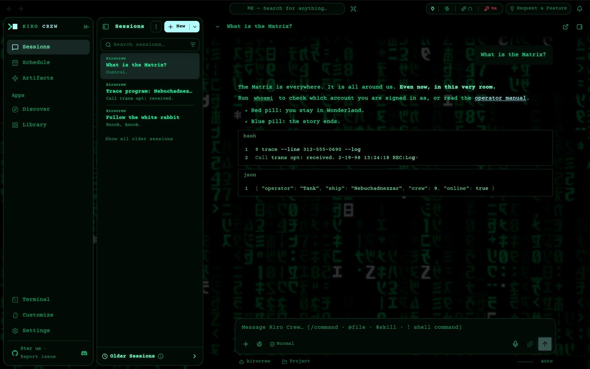
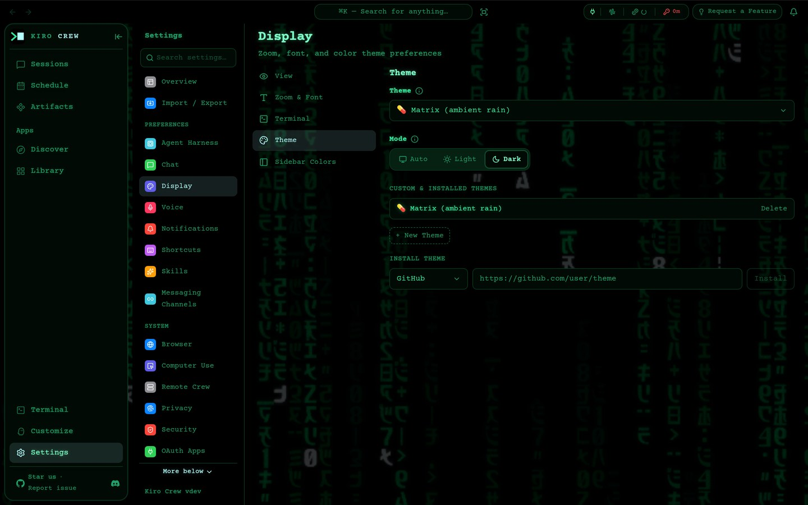
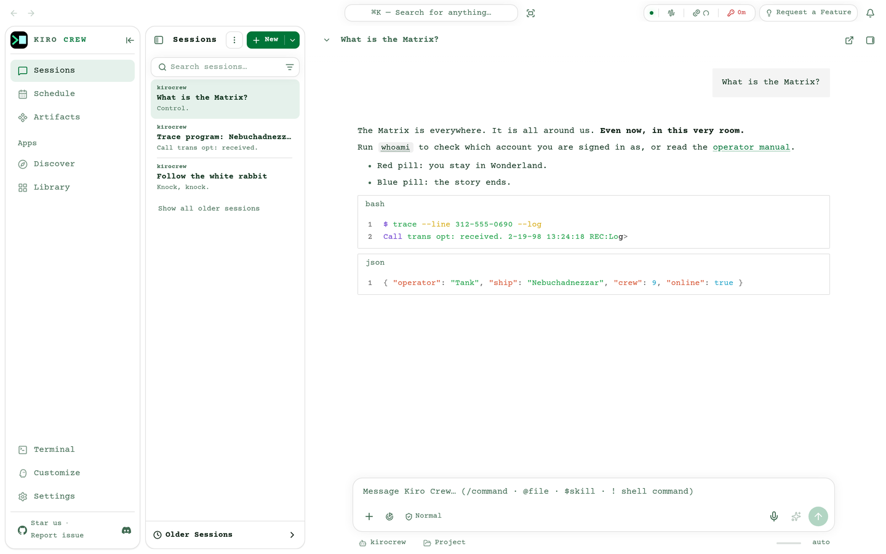
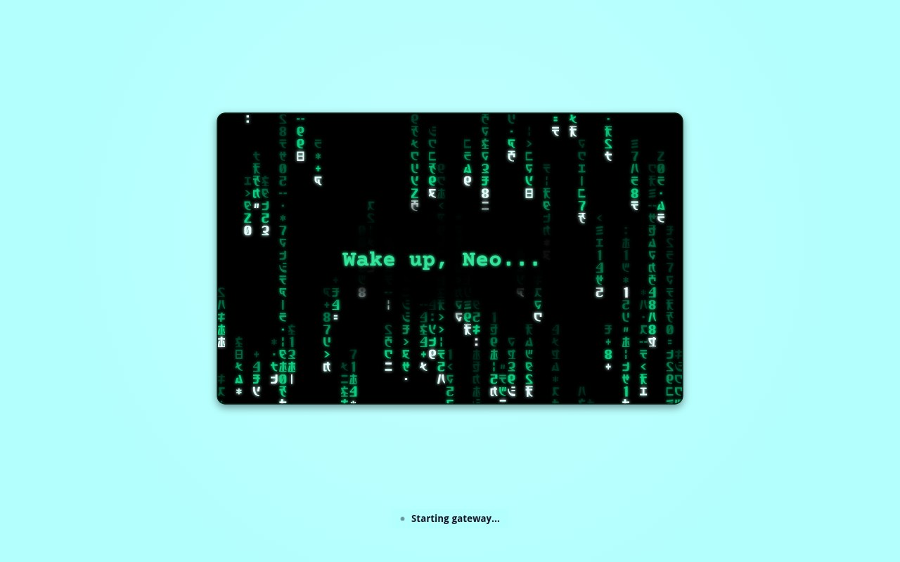
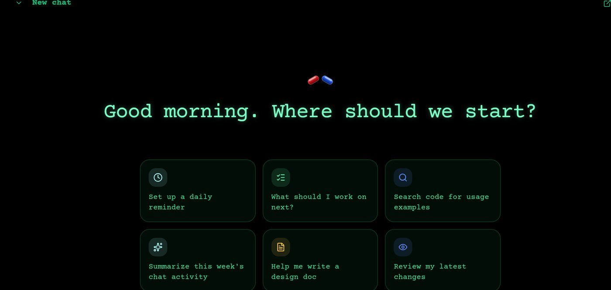
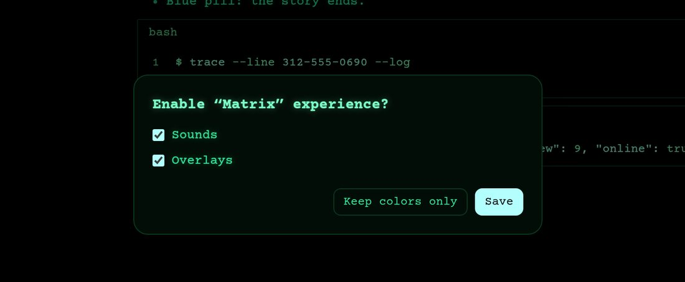

# Kiro Crew theme: Matrix (ambient rain)

An unofficial [Kiro Crew](https://github.com/kirodotdev/KiroCrew) theme pack modeled on the computer screens in *The Matrix* (1999).

This is the [Matrix pack](https://github.com/leozhad/kirocrew-theme-matrix) with dim digital rain playing behind the chat all the time, in place of the idle screensaver. The colors, fonts, cursor, welcome mark and sounds are the same.

| Repo | What it is |
|---|---|
| [kirocrew-theme-matrix](https://github.com/leozhad/kirocrew-theme-matrix) | The full pack (Level 2): colors, fonts, cursor, welcome mark, sounds, the idle screensaver and the desktop splash |
| This one | The same pack with rain behind the chat and no screensaver, plus the welcome mark, sounds and desktop splash (Level 2) |
| [kirocrew-theme-matrix-quiet](https://github.com/leozhad/kirocrew-theme-matrix-quiet) | Retired on Nov 17, 2026 and archived. For the same look, use either pack with Settings → Display → Theme → Experience → Overlays turned off |

| Part | What it does |
|---|---|
| Dark mode | Neo's terminal: black CRT, green phosphor text with glow, Courier type, the film's block cursor color, code blocks in one green, and dim rain behind it all |
| Light mode | The Construct (the white loading program): neutral white with green ink, no rain |
| Thinking indicator | A blinking block cursor |
| Welcome mark | The red pill and the blue pill, on a new chat's welcome screen |
| Sounds | Original sounds inspired by the films: a jack-in when you pick the theme, an unplug when you leave it, falling code for a notification, an old phone ringing when an approval waits for you ([details](#sounds)) |
| Terminal | The built-in Terminal selects text in phosphor green |
| Desktop splash | While the desktop app starts its gateway: the digital rain with "Wake up, Neo..." and the blinking block cursor |

## Screenshots

| Rain behind the chat | Rain behind Settings |
|---|---|
|  |  |

| Light mode |
|---|
|  |

| Desktop splash (dark mode) |
|---|
|  |

| Welcome mark: a new chat | First pick: Kiro Crew asks about Sounds and Overlays |
|---|---|
|  |  |

## Install

Needs Kiro Crew 0.13.0 or newer.

1. Open Settings → Display → Theme.
2. Under **Install Theme**, choose **GitHub** and paste `https://github.com/leozhad/kirocrew-theme-matrix-ambient`.
3. Install, then pick **💊 Matrix (ambient rain)** in the Theme list.

Courier Prime feeds both the Sans and Mono font roles. To keep your OS font, pick System under Settings → Display → Font Family.

The first time you choose the theme, Kiro Crew asks which parts to turn on: Sounds and Overlays (the rain). To stop the rain but keep the colors, turn off Settings → Display → Theme → Experience → Overlays.

To update, install the same URL again.

### From a .zip file

You can also install from a `.zip`, for example from a phone or another browser that is not on the gateway's machine:

1. On this page, choose **Code → Download ZIP**.
2. Open Settings → Display → Theme.
3. Under **Install Theme**, set **Theme source** to **Zip file**, choose the downloaded `.zip` and install.

## How the rain behaves

- **Behind everything.** The rain paints under the nav, the session list, the chat header, message bubbles, code blocks and the composer, so it shows only in the open space of a page. It takes no clicks.
- **Contrast.** The rain uses the film's colors at 3% of their light, in linear light. Over the brightest glyph, body text (`--text`) keeps 7.9:1, bright text (`--text-strong`) 10.4:1 and muted text (`--muted`) 4.55:1.
- **Motion.** It moves like the film's opening titles, measured at the film's 24 frames per second. Drop heads jump whole cells on each film frame: mostly one row, sometimes none or two. They fall at 9–37 rows a second (median about 22), about one screen height a second. Most trails are a few rows long and some run past the screen height. About two drops share a column, about 70% of cells are lit, and a lit glyph changes about once a second. The glyph shapes and grid are the screensaver's, and the hues stay within 5° of it.
- **Light mode** stays plain white. In the film the Construct is empty white space, and the rain only appears on the black operator screens. On white, the rain would have to be dark ink, which is a different effect.
- **Reduced motion.** When the OS asks for reduced motion, Kiro Crew does not load the rain, and the page shows a plain black background.
- **CPU.** 24 frames per second, drawn at half resolution, paused while the tab is hidden and in light mode. In headless Chromium with software rendering, a frame takes about 5–6 ms, and the rain uses about 20–22% of one core.

The rain follows the film's rules as documented by [Rezmason/matrix](https://github.com/Rezmason/matrix): glyphs sit in a fixed grid and never move, a drop is a wave of light passing down a column, drops in one column never collide, some heads flare white, and glyphs flicker.

## Sounds

The pack ships four short sounds in `audio/`. They are original: a script made them from sine waves, filtered noise and envelopes, with a fixed seed. They hold no audio from the films. They are made to recall the film's moments.

| When | File | Sound |
|---|---|---|
| You pick the theme (`activate`) | `jack-in.wav`, 1.6 s | The headjack seating with a metallic tick and a thump, an electric whine that climbs, then code shimmering in |
| You switch to another theme (`deactivate`) | `unplug.wav`, 0.8 s | The whine falling away and a soft pop |
| A notification (`notification`) | `rain.wav`, 0.95 s | Falling code: three columns of blips that step down in pitch, one step per film frame (1/24 s) |
| An approval waits for you (`category:approval`) | `phone.wav`, 1.9 s | One ring of an old two-bell landline: the operator calling |

- **Quiet.** Peaks sit at -6 dBFS, and the pack plays them at 40%–50% volume. Each stays under Kiro Crew's cap for its trigger (5 s for `activate`, 2 s for the rest).
- **When they play.** Kiro Crew asks the first time you choose the theme, with one box for Sounds and one for Overlays. Change it later under Settings → Display → Theme → Experience → Sounds. A mute button sits at the bottom right while the theme is active. Sounds never play when the OS is set to reduce motion.
- **Your settings win.** A notification category you gave its own sound under Settings → Notifications → Per-category sounds keeps that sound, and Mute sounds there silences the theme too.

### Use your own sounds

Kiro Crew plays whatever files the pack's `audio/manifest.json` names, so you can swap in your own for your own install:

1. Download this repo (**Code → Download ZIP**) and unzip it, or clone it, on the machine that runs the Kiro Crew gateway.
2. Replace any of `audio/jack-in.wav`, `unplug.wav`, `rain.wav` or `phone.wav` with your own file of the same name. Or add a file and point a trigger at it in `audio/manifest.json`. The triggers are `activate`, `deactivate`, `message-sent`, `message-received`, `error`, `notification` and `category:<name>`.
3. Keep each file `.wav`, `.mp3` or `.ogg`, with a lower-case name of letters, digits and dashes, under 512 KB, and under the trigger's time cap (5 s for `activate`, 3 s for `error`, 1 s for the two message triggers, 2 s for the rest). Install checks the file's first bytes, so a renamed file of another type is refused.
4. Install that folder through Settings → Display → Theme → Install Theme → Local folder. Install validates it; a refusal names what to change.

Keep audio you do not own, such as clips from the films, out of any repo you push. This repo's `.gitignore` ignores `local-audio/` and `audio-film/` folders for that reason.

## Desktop splash

While the Kiro Crew desktop app starts its gateway, it shows the pack's `branding/splash.svg`: Neo's screen, black with the digital rain, "Wake up, Neo..." in Courier Prime Bold and the film's block cursor, blinking.

- **Where.** Only the desktop app shows it, on its own backdrop, which follows the theme accent: pale cyan-white in dark mode, green in light mode.
- **When.** The app keeps the art the dashboard last reported, so it shows from the next launch after you pick the theme.
- **Motion.** Glyphs sit in a fixed grid, drops are light passing down a column, and heads jump whole cells at 24 frames a second. Under reduced motion it holds one still frame.

## Code views

In dark mode, fenced code blocks are shown in one green, like a monochrome CRT. Diffs and file views have no theme hook, so the pack picks their syntax colors: `github-dark-default` in dark mode (comments, keywords, strings, functions, numbers and types all at 6.8:1 or more over black) and `light-plus` in light mode (green comments; the same token kinds all at 4.5:1 or more over white).

## What a pack cannot change

- **Fixed colors.** The Settings section icon tiles and the glass search bar keep fixed colors.
- **Reduced motion.** The thinking cursor holds still and no sound plays when the OS asks for reduced motion.

## Credits and licenses

See [`LICENSE.txt`](LICENSE.txt):

- The pack is MIT, including its sounds, which are synthesized.
- Rezmason's `Matrix-Code.ttf` glyph art, embedded in `overlays/ambient.html`, is MIT. He recovered the glyph shapes from an official promo SWF, and Warner Bros. may hold rights in that original art.
- Courier Prime is under SIL OFL 1.1.

"The Matrix" is a trademark of Warner Bros. This fan theme has no affiliation with Warner Bros.
