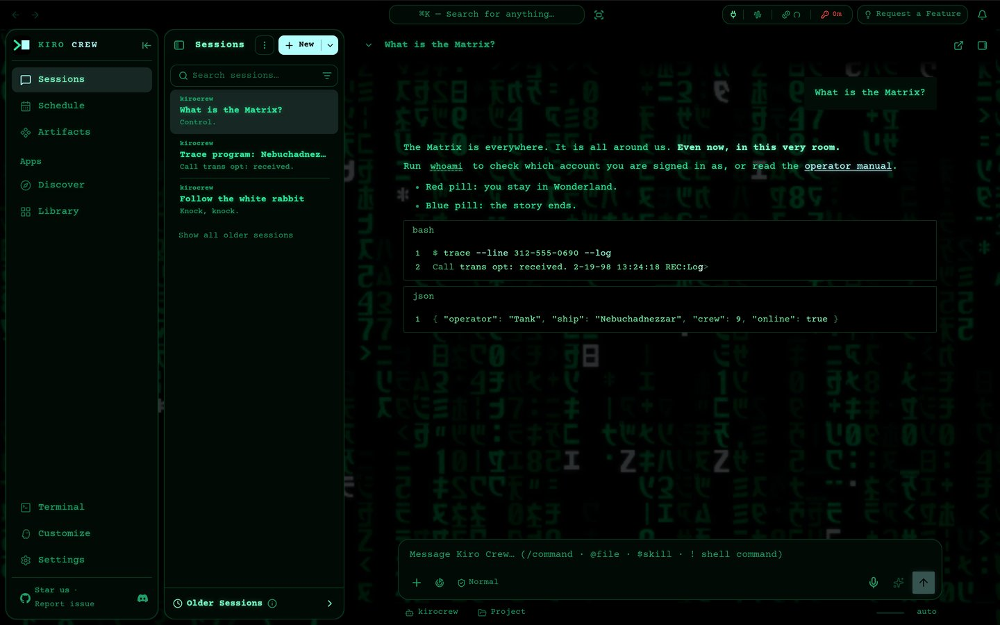
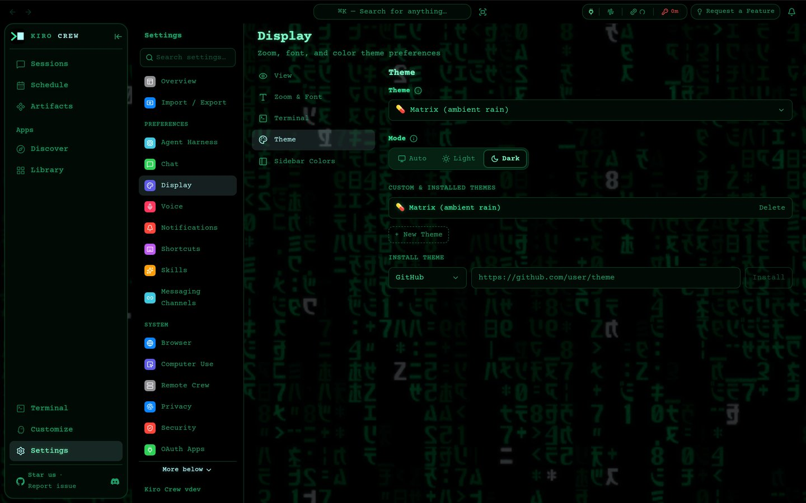
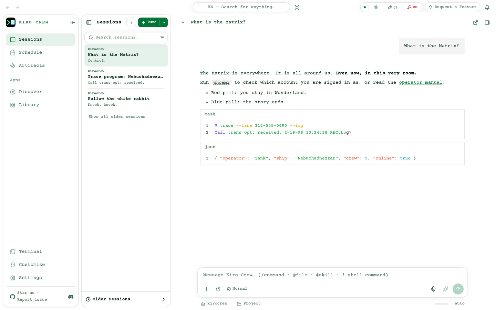

# Kiro Crew theme: Matrix (ambient rain)

An unofficial [Kiro Crew](https://github.com/kirodotdev/KiroCrew) theme pack modeled on the computer screens in *The Matrix* (1999).

This is the [Matrix pack](https://github.com/leozhad/kirocrew-theme-matrix) with dim digital rain playing behind the chat all the time, in place of the idle screensaver. The colors, fonts and cursor are the same.

| Repo | What it is |
|---|---|
| [kirocrew-theme-matrix](https://github.com/leozhad/kirocrew-theme-matrix) | The full pack (Level 2): colors, fonts, cursor, and the idle screensaver |
| [kirocrew-theme-matrix-quiet](https://github.com/leozhad/kirocrew-theme-matrix-quiet) | The same pack without the screensaver (Level 1) |
| This one | The same pack with rain behind the chat and no screensaver (Level 2) |

| Part | What it does |
|---|---|
| Dark mode | Neo's terminal: black CRT, green phosphor text with glow, Courier type, the film's block cursor color, code blocks in one green, and dim rain behind it all |
| Light mode | The Construct (the white loading program): neutral white with green ink, no rain |
| Thinking indicator | A blinking block cursor |

## Screenshots

| Rain behind the chat | Rain behind Settings |
|---|---|
|  |  |

| Light mode |
|---|
|  |

## Install

Needs Kiro Crew 0.11.1 or newer. That release added the `"layer": "behind"` overlay option. Older versions ignore it and draw the rain over the chat.

1. Open Settings → Display → Theme.
2. Under **Install Theme**, choose **GitHub** and paste `https://github.com/leozhad/kirocrew-theme-matrix-ambient`.
3. Install, then pick **💊 Matrix (ambient rain)** in the Theme list.

Courier Prime feeds both the Sans and Mono font roles. To keep your OS font, pick System under Settings → Display → Font Family.

To update, install the same URL again.

## How the rain behaves

- **Behind everything.** The rain paints under the nav, the session list, the chat header, message bubbles, code blocks and the composer, so it shows only in the open space of a page. It takes no clicks.
- **Contrast.** The rain uses the film's colors at 3% of their light, in linear light. Over the brightest glyph, body text (`--text`) keeps 7.9:1 and bright text (`--text-strong`) 10.4:1. Muted text (`--muted`) drops to 3.8:1 where it sits over the rain.
- **Motion.** It moves like the film's opening titles, measured at the film's 24 frames per second. Drop heads jump whole cells on each film frame: mostly one row, sometimes none or two. They fall at 9–37 rows a second (median about 22), about one screen height a second. Most trails are a few rows long and some run past the screen height. About two drops share a column, about 70% of cells are lit, and a lit glyph changes about once a second. The glyph shapes and grid are the screensaver's, and the hues stay within 5° of it.
- **Light mode** stays plain white. In the film the Construct is empty white space, and the rain only appears on the black operator screens. On white, the rain would have to be dark ink, which is a different effect.
- **Reduced motion.** When the OS asks for reduced motion, Kiro Crew does not load the rain, and the page shows a plain black background.
- **CPU.** 24 frames per second, drawn at half resolution, paused while the tab is hidden and in light mode. In headless Chromium with software rendering, a frame takes about 5–6 ms, and the rain uses about 20–22% of one core.

The rain follows the film's rules as documented by [Rezmason/matrix](https://github.com/Rezmason/matrix): glyphs sit in a fixed grid and never move, a drop is a wave of light passing down a column, drops in one column never collide, some heads flare white, and glyphs flicker.

## What a pack cannot change

- **Fixed colors.** The Settings section icon tiles and the glass search bar keep fixed colors.
- **Reduced motion.** The thinking cursor still blinks when the OS asks for reduced motion, because browsers do not pass that setting to SVG images.

## Credits and licenses

See [`LICENSE.txt`](LICENSE.txt):

- The pack is MIT.
- Rezmason's `Matrix-Code.ttf` glyph art, embedded in `overlays/ambient.html`, is MIT. He recovered the glyph shapes from an official promo SWF, and Warner Bros. may hold rights in that original art.
- Courier Prime is under SIL OFL 1.1.

"The Matrix" is a trademark of Warner Bros. This fan theme has no affiliation with Warner Bros.
